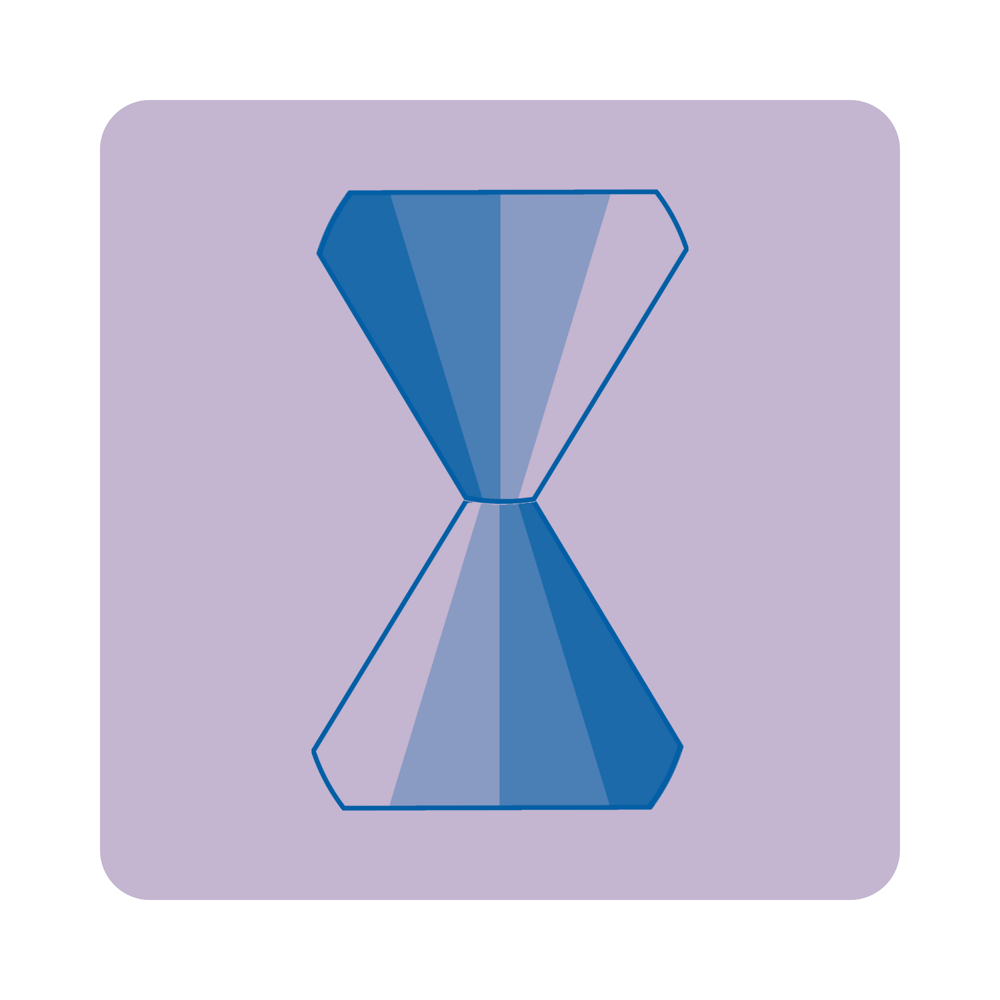

<div align="center">



# ⏱️ Desky — Yeolpumta 桌面客户端

**为 Yeolpumta (YPT) 学习平台打造的现代化、强大且优雅的桌面客户端。**

[](https://flutter.dev)
[](https://github.com/huneyoliv/desky/releases)
[](https://github.com/huneyoliv/desky/releases)
[](LICENSE)
[](https://github.com/huneyoliv/desky/actions)
[](https://github.com/huneyoliv/desky)

**[English](README.md)** • **[Português (Brasil)](README.pt-BR.md)** • **[简体中文](README.zh-CN.md)**

[核心功能](#-核心功能) •
[下载安装](#-下载与安装) •
[架构设计](#-架构与技术栈) •
[本地开发](#-本地开发指南) •
[法律声明](#-法律免责声明) •
[开源许可证](#-开源许可证)

</div>

---

## 📖 项目简介

**Desky** 专为在 Windows、macOS 和 Linux 电脑前专注学习的学生打造。它采用受 Yeolpumta 启发的 AMOLED 纯黑深色界面，并针对高分辨率显示屏进行了全面优化，将手机端的所有核心学习与专注能力无缝带到电脑桌面。

---

## ✨ 核心功能

### ⏱️ 学习计时器与番茄钟
- **普通计时与番茄钟模式**：支持自定义专注时长、短休息与长休息周期。
- **科目精细化管理**：科目创建、编辑、归档，支持专属颜色调色板。
- **手动时间补录**：支持补充记录过去的学习时长并实时计入统计。
- **离线持久化同步**：网络不稳定时自动在本地排队，重新连网后无缝解决冲突并同步到云端。

### 🛡️ 专注模式与防分心拦截
- **软件进程监控**：自动检测学习期间打开的分心软件并弹出警告提示。
- **严格专注模式**：锁定侧边栏导航，沉浸式深度学习不中断。
- **置顶悬浮 Mini Player**：紧凑小巧的 Always-on-Top 计时窗口，多任务查阅资料时时间随时可见。

### 👥 学习小组与实时打卡 (Live Study)
- **实时成员动态流**：查看小组内正在学习的成员、当前科目及动态卡通人物状态。
- **Live Study 拍照打卡**：支持摄像头定时打卡拍照并安全上传验证。
- **小组聊天互动**：支持富文本消息、Emoji 反应、图片附件以及官方 YPT 贴纸。
- **唤醒振动提醒**：支持向同组伙伴发送 Shake 提醒，相互勉励。

### 🎮 Discord Rich Presence (RPC)
- **实时状态同步**：将你当前正在学习的科目、计时用时以及小组名称实时广播至 Discord 个人资料状态。
- **自动状态切换**：在“学习中”、“休息中”以及“离开”状态间智能平滑切换。

### 🔒 安全桌面身份验证 (OAuth PKCE)
- **邮箱与密码登录**：支持通过邮箱验证码进行密码安全重置。
- **Google OAuth (PKCE)**：通过本地环回端口在系统默认浏览器中完成登录，规避内嵌 WebView 潜在安全漏洞。

### 📅 日程规划、课程表与倒计时 (D-Day)
- **D-Day 考试倒计时**：直观展示重大考试、目标日期的剩余倒数天数。
- **智能 To-Do 待办清单**：支持任务优先级、截止日期及循环重复规则。
- **周课程表 (Timetable)**：按科目时间块直观规划每周学习日程。

### 📊 全球排行榜与学习热力图
- **多维度排行榜**：实时按日、周、月查看全球、全国以及同分类学习时长排名。
- **年度学习热力图**：GitHub 风格的 365 天矩阵，直观展示每天的学习强度与坚持度。
- **月度日历统计**：日历视图查看每日目标达成与连续打卡天数（Streaks）。

### 🃏 记忆卡片与内置 PDF 阅读器 (Smartbook)
- **自定义卡组**：基于 SM-2 间隔重复算法，按科目智能复习记忆卡片。
- **内置 PDF 阅读器**：直接在应用内阅读教材教辅，支持页面书签并在阅读时一键生成记忆卡片。

### 📹 学习延时摄影 (Timelapse)
- 学习会话自动定时截图，内置延时摄影播放器与画廊浏览。

### 🎨 虚拟形象与商城
- 可定制的卡通娃娃形象，支持装扮、配饰以及随学习状态变化的丰富动态姿势。

### 🔔 消息通知中心
- 集中管理小组公告、好友互动提醒及新版本更新通知。

### 🌐 全球多语言支持 (i18n)
- 原生支持包括简体中文在内的 28 种语言，运行时热切换无需重启。

### 🔄 应用内版本更新提示
- 自动检测 GitHub Releases 发布的最新版本，侧边栏弹出版本指示器。
- 内置更新日志对话框，并提供系统对应原生安装包的一键直链下载。

---

## 💻 下载与安装

您可以在官方 [**Releases 页面**](https://github.com/huneyoliv/desky/releases/latest) 下载最新版本：

| 操作系统 | 安装包文件 | 格式 | 安装说明 |
| :--- | :--- | :--- | :--- |
| **Windows** | `Desky-Windows-Installer-x64.exe` | 可执行安装程序 | 运行 `.exe` 安装程序并按照向导完成安装。 |
| **Windows** | `Desky-Windows-x64.msix` | MSIX 现代化应用包 | 支持 Windows App Installer / 微软应用商店格式直接安装。 |
| **macOS** | `Desky-macOS-Installer.dmg` | 磁盘映像 | 打开 `.dmg` 文件并将 `Desky.app` 拖入 `Applications` 文件夹。 |
| **Linux (Debian/Ubuntu)** | `Desky-Linux-x64.deb` | Debian 软件包 | 终端运行 `sudo apt install ./Desky-Linux-x64.deb` 或 `sudo dpkg -i Desky-Linux-x64.deb`。 |
| **Linux (其他发行版)** | `Desky-Linux-x64.tar.gz` | 便携归档文件 | 解压 `.tar.gz` 归档并直接运行 `./desky` 二进制文件。 |

---

## 🏗️ 架构与技术栈

项目基于 **Clean Architecture (整洁架构)** 规范组织代码，层级职责清晰：

```
lib/
├── core/                  # 核心服务、网络、主题、常量与国际化
│   ├── api/               # HTTP 客户端 (Dio) 与认证拦截器
│   ├── cdn/               # 虚拟形象与静态资源的动态 CDN 解析器
│   ├── constants/         # API 端点与应用全局常量
│   ├── localization/      # 翻译引擎与回退字典 (支持 28 种语言)
│   ├── oauth/             # Google OAuth PKCE 与本地环回服务器
│   ├── services/          # 系统服务 (防分心、摄像头、更新检查、窗口控制、Discord RPC)
│   └── theme/             # AMOLED 纯黑主题调色板、排版与视觉样式
├── data/                  # 数据层、数据传输对象 (DTO) 与仓储
│   ├── models/            # 带有 JSON 序列化的数据模型
│   └── repositories/      # API 通信与数据访问抽象接口
├── features/              # 按功能划分的模块
│   ├── auth/              # 邮箱认证与 Google OAuth PKCE
│   ├── challenges/        # 学习挑战与社区打卡目标
│   ├── flashcards/        # 记忆卡片管理与 SM-2 算法
│   ├── groups/            # 学习小组、出勤统计、聊天与 Live Study
│   ├── notifications/     # 通知中心与系统消息
│   ├── planner/           # 待办清单 (To-Do)、D-Day 倒计时与周课程表
│   ├── profile/           # 用户个人资料与账户安全
│   ├── ranks/             # 全球排行榜、年度热力图矩阵与月历
│   ├── settings/          # 学习偏好、语言切换与法律条款
│   ├── smartbook/         # 内置 PDF 阅读器与学习资料查看器
│   ├── store/             # 形象装扮道具背包与商城
│   ├── timelapse/         # 学习延时录屏与播放画廊
│   ├── timer/             # 核心学习计时器、番茄钟、Mini Player 与科目管理
│   └── updates/           # 版本检查、更新日志展示与直链下载
└── shared/                # 通用公共组件 (AppShell、SidebarNav、TitleBar、Avatars)
```

### 核心依赖库：
- **核心框架**：[Flutter Desktop](https://flutter.dev) (Dart 3.x)
- **状态管理**：[Flutter Riverpod](https://riverpod.dev)
- **路由导航**：[GoRouter](https://pub.dev/packages/go_router)
- **网络请求**：[Dio](https://pub.dev/packages/dio)
- **安全存储**：[flutter_secure_storage](https://pub.dev/packages/flutter_secure_storage) 与 [shared_preferences](https://pub.dev/packages/shared_preferences)
- **图表与动画**：[FL Chart](https://pub.dev/packages/fl_chart) 与 [Lottie](https://pub.dev/packages/lottie)
- **原生窗口控制**：[window_manager](https://pub.dev/packages/window_manager)

---

## 🛠️ 本地开发指南

### 环境要求
- [Flutter SDK](https://flutter.dev/docs/get-started/install) (`>= 3.0.0`)
- **Windows**：Visual Studio 2022（需勾选“使用 C++ 的桌面开发”工作负载）。
- **macOS**：Xcode 15+ 及命令行开发工具。
- **Linux**：系统构建依赖项：
  ```bash
  sudo apt-get install clang cmake ninja-build pkg-config libgtk-3-dev liblzma-dev libsecret-1-dev libjsoncpp-dev
  ```

### 克隆代码仓库
```bash
git clone https://github.com/huneyoliv/desky.git
cd desky
```

### 获取项目依赖
```bash
flutter pub get
```

### 本地调试运行
```bash
# Windows
flutter run -d windows

# macOS
flutter run -d macos

# Linux
flutter run -d linux
```

### 执行自动化测试与代码分析
```bash
# 运行全部自动化测试
flutter test

# 静态代码规范分析
flutter analyze
```

---

## ⚖️ 法律免责声明

**Desky** 是一个独立的开源第三方客户端，与 **Pallo Inc.** 或 **Yeolpumta (YPT)** 没有任何官方附属、认可、赞助或合作关系。所有相关商标均归其各自所有者所有。

---

## 📄 开源许可证

本项目基于 [MIT](LICENSE) 开源许可证分发与使用。
